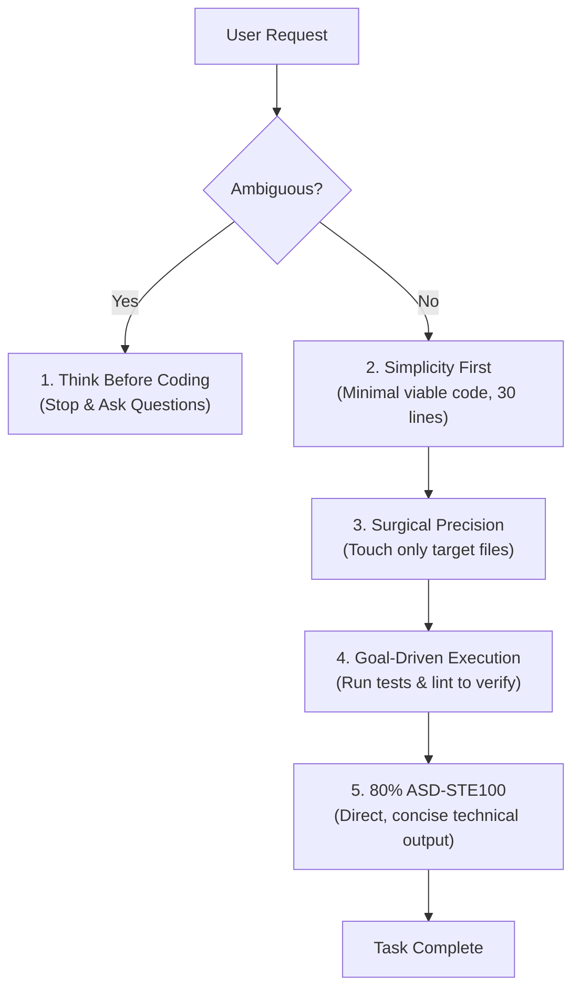

# Karpathy Guardrails 🛡️

[](LICENSE)
[](https://claude.ai)
[](#)

> **Automated skill, templates, and generator to enforce Andrej Karpathy's agentic engineering principles across Claude Code, Antigravity, Cursor, and universal AI coding agents.**

---

## Why Karpathy Guardrails?

In his viral reflections on **"vibe coding"** and agent-driven development, **Andrej Karpathy** noted that developers are shifting from writing code line-by-line to orchestrating autonomous AI agents. 

However, without explicit guardrails, frontier LLMs predictably fall into four chronic failure modes:
1. **Silent guessing** instead of asking clarifying questions.
2. **Over-engineering** simple 30-line tasks into 300-line enterprise architectures.
3. **Collateral edits** that refactor or reformat untouched files.
4. **Infinite churn loops** without clear definitions of when a task is finished.

**Karpathy Guardrails** turns these observations into a lightweight, enforceable system.

---

## The 4 Core Guardrails



1. **Think Before Coding:** Prohibits silent assumptions. If requirements are ambiguous, the agent must ask clarifying questions before touching code.
2. **Simplicity First:** Aggressively penalizes over-engineering. A clean 30-line solution is strictly preferred over 200 lines of premature abstractions.
3. **Surgical Precision:** Changes are strictly confined to the requested scope. The agent is banned from reformatting or modifying untouched code.
4. **Goal-Driven Execution:** Requires automated test and lint verification before declaring any task done.
5. **80% ASD-STE100 Output:** Strips away conversational fluff, polite preamble, and vague hedging. Enforces active voice, short imperative sentences (<20 words), and unambiguous technical clarity based on Simplified Technical English.

---

## Quick Start (3 Ways to Use)

### Option 1: Automatic Setup via Script (Zero Dependencies)

Run this one-liner inside any repository:

```bash
curl -fsSL https://raw.githubusercontent.com/nazmulislam-lab/karpathy-guardrails/main/scripts/scaffold-rules.sh | bash
```

The script automatically detects your language/framework (Node, Python, Go, Rust, etc.) and generates:
- `CLAUDE.md` (for Claude Code)
- `AGENTS.md` (for Antigravity, Gemini CLI, and universal agents)

---

### Option 2: Install as an Agent Skill

Drop the skill into your agent's skills directory:

#### For Claude Code:
```bash
git clone https://github.com/nazmulislam-lab/karpathy-guardrails.git ~/.claude/skills/karpathy-guardrails
```

#### For Antigravity / Gemini CLI:
```bash
git clone https://github.com/nazmulislam-lab/karpathy-guardrails.git ~/.gemini/skills/karpathy-guardrails
```

Then simply prompt your agent:
> *"Initialize Karpathy guardrails for this project."*

---

### Option 3: Manual Drop-In Templates

Copy the pre-made templates directly into your project root:

- **Claude Code CLI:** Copy [`templates/CLAUDE.md`](templates/CLAUDE.md) to your repo's root as `CLAUDE.md`.
- **Universal Agents (Antigravity, Codex, etc.):** Copy [`templates/AGENTS.md`](templates/AGENTS.md) to `AGENTS.md`.
- **Cursor / Windsurf:** Copy [`templates/karpathy-guidelines.mdc`](templates/karpathy-guidelines.mdc) to `.cursor/rules/karpathy-guidelines.mdc`.

---

## Repository Structure

```
karpathy-guardrails/
├── SKILL.md                          # Official Agent Skill definition
├── README.md                         # Documentation & Quick Start
├── LICENSE                           # MIT License
├── CHANGELOG.md                      # Version history
├── templates/
│   ├── CLAUDE.md                     # Ready-to-use template for Claude Code
│   ├── AGENTS.md                     # Universal agent governance template
│   └── karpathy-guidelines.mdc       # Cursor / Windsurf rules template
├── scripts/
│   └── scaffold-rules.sh             # Stack-aware auto-detection script
└── references/
    ├── karpathy-principles.md        # Detailed breakdown of LLM failure modes
    └── vibe-coding-guide.md          # Best practices for hands-off vibe coding
```

---

## References & Further Reading

- [The Karpathy Principles](references/karpathy-principles.md) — Why LLMs fail at coding and how guardrails solve it.
- [Vibe Coding Practical Guide](references/vibe-coding-guide.md) — Voice dictation, reasoning effort, and terminal delegation.
- [Exindel: How Andrej Karpathy Uses Claude Code & AI Agents](https://exindel.com/how-andrej-karpathy-uses-claude-code-and-ai-agents/)

---

## Author & License

Created by **Md Nazmul Islam** ([@nazmulislam-lab](https://github.com/nazmulislam-lab)), inspired by Andrej Karpathy's agentic engineering observations.

Released under the [MIT License](LICENSE).
